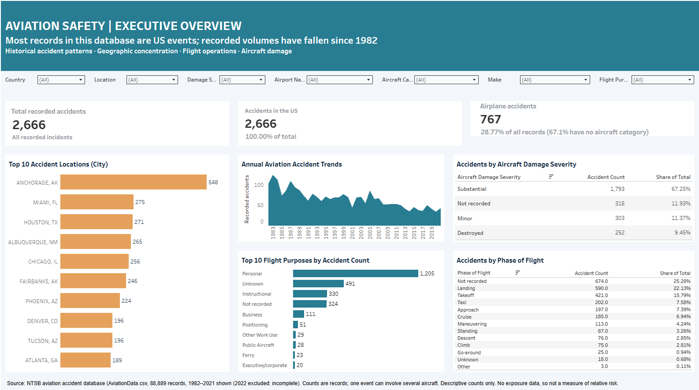

# Aviation Safety: Executive Overview (Tableau)

**Live interactive dashboard:** [Open on Tableau Public](https://public.tableau.com/app/profile/gospel.ayodele.iyioku/viz/AviationSafetyExecutiveOverview/Overview)

An executive dashboard on 88,889 recorded aviation accident and incident records. It answers where recorded accidents are concentrated, how volumes have changed over time, and which flight purposes, phases of flight, aircraft categories and damage classes account for the largest shares. It also makes the quality of the underlying record visible, so that readers do not over-interpret it.

## Business questions

1. Where are recorded accidents most concentrated, and how has their volume evolved?
2. Which flight purposes and phases of flight account for the largest shares?
3. How are accidents distributed across aircraft categories and damage-severity classes?

The full brief is in [docs/Project_Brief.pdf](docs/Project_Brief.pdf).

## Data

- **Source:** US National Transportation Safety Board (NTSB) aviation accident database, as the file `AviationData.csv`.
- **Size and coverage:** 88,889 records with 31 fields. Dates run from 1948 to 2022, but only 7 records fall before 1982; the database is effectively complete from 1982 onward.
- Neither the raw file nor the Tableau workbook is stored in this repository; the interactive dashboard is published on Tableau Public (link above).

## Headline findings

| Finding | Evidence |
|---|---|
| Recorded accident volume fell by about 57% between 1982 and 2021 | 3,593 records in 1982, 1,545 in 2021 (low of 1,392 in 2020). This is a count, not a rate: there is no flight-hours or departures denominator, so it does not show that flying became safer per flight. |
| Most records involve substantial or total aircraft damage | Substantial 72.2% (64,148), destroyed 20.9% (18,623), minor 3.2%, not recorded 3.6%. |
| Personal flying dominates by purpose | Personal 55.6% (49,448); instructional 11.9% (10,601). |
| Landing and takeoff are the most common recorded phases | Landing 17.4%, takeoff 14.0%, cruise 11.6%. The largest single group is **not recorded** (30.6%), so phase shares are understated for every named phase. |
| Anchorage is the most frequent recorded location | 548 records, twice the next-largest (Miami, 275). Alaska's Anchorage and Fairbanks together account for 794 records. Counts reflect activity levels as well as risk, which this data cannot separate. |

Top 10 locations by recorded accident count (location strings normalised for case and spacing): Anchorage AK 548, Miami FL 275, Houston TX 271, Albuquerque NM 265, Chicago IL 256, Fairbanks AK 246, Phoenix AZ 224, Tucson AZ 196, Denver CO 196, Atlanta GA 189.

## Data quality notes (important for interpretation)

- **US-centric coverage.** 92.5% of records (82,248) are US events. This reflects what the NTSB database covers, not where accidents happen worldwide.
- **Aircraft category is missing for 63.7% of records** (56,602). Airplanes are 31.1% of all records (27,617), but 85.5% of records that have a category. The dashboard shows the share of all records; read it with this in mind.
- **Records are not unique events.** 911 event IDs appear more than once because a single event can involve several aircraft. There are 84,441 distinct events behind the 88,889 records.
- **Location is free text and inconsistent in case** (for example "ANCHORAGE, AK" and "Anchorage, AK"). Counting them as separate places understates the top locations, so the dashboard normalises them first. 40% of records have no airport name, so "location" here is the event's city, not an airport.
- **Descriptive only.** Nothing here shows causation or relative safety risk; that needs exposure data and a rate-based analysis.

## How it was built

- **Tool:** Tableau (published to Tableau Public); data connected from CSV and packaged as an extract.
- **Calculated fields:** accident count `COUNT([Event.Id])`; US accidents `COUNT(IF [Country]='United States' THEN [Event.Id] END)`; airplane accidents `COUNT(IF [Aircraft.Category]='Airplane' THEN [Event.Id] END)`; share-of-total measures as ratios of those to the overall count.
- **Views:** KPI tiles; top-10 location bar chart; annual trend (area); flight purpose bar chart; damage severity and phase-of-flight tables with share of total; shared filters for country, damage, airport, aircraft category, make and flight purpose.
- **Design choices:** a headline that states the takeaway, one teal palette with a contrast colour for the geographic view, and the data-quality caveats shown next to the numbers they qualify.

## Files

The workbook itself is published on Tableau Public only.

- `images/dashboard-overview.png`: screenshot of the dashboard
- `docs/Project_Brief.pdf`: the project brief

## Possible extensions

Normalise rates by exposure data (flight hours or departures); add fatality and injury severity; model the trend with a regression that controls for category and purpose; map events by latitude and longitude where present.
